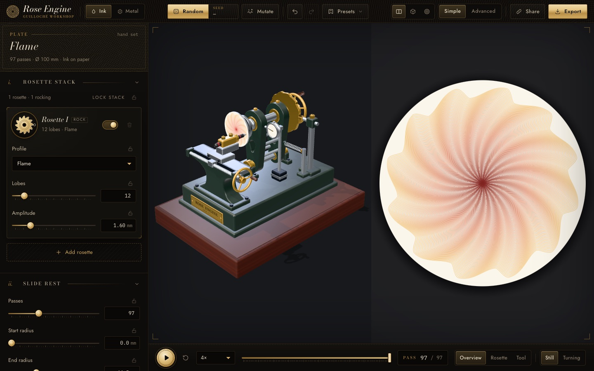
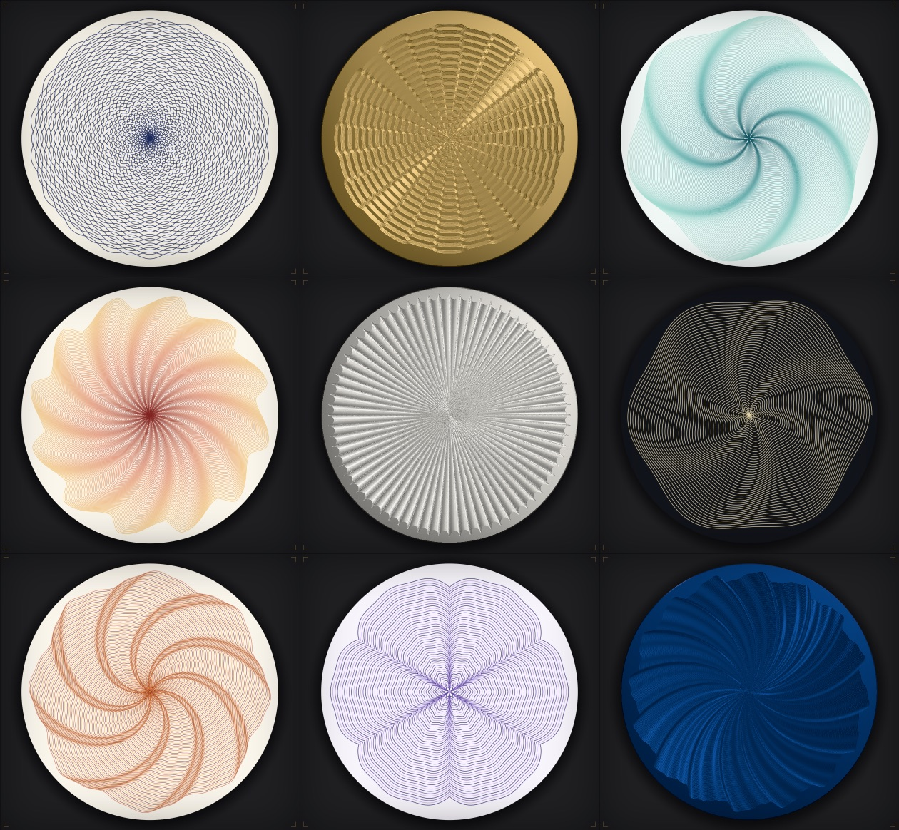

# Rose Engine

A guilloché lathe in the browser. Set up the rosettes (cams) and machine settings, then watch a 3D rose engine cut the pattern while a flat view shows the plate. Draw in coloured ink or engrave in metal, then export the result.

**Live:** https://rose-engine.balian.dev



## Features

- **Rosette stack:** rocking (radial) and pumping (depth) rosettes with sine, convex, concave, flame, square, saw and triangle profiles, up to 300 lobes for watch-dial barleycorn. A roller "rubber" follower rounds off sharp profiles the way a real one does.
- **Slide rest:** start/end radius and pass count. Phasing can be linear drift, alternate (barleycorn, basket weave) or a custom list. Also amplitude taper and a continuous spiral feed. Patterns can run right into the centre.
- **Plate & symmetry:** plate size from 20 to 300 mm with watch-dial quick picks (changing size rescales the design), Fill to edge (passes run past the rim and are clipped there), and a symmetry setting (4/6/8/12/24-fold or custom, with optional mirror) that keeps lobe counts and phasing harmonious.
- **Chucks:** eccentric (offset and divisions, for rosaces) and elliptical (ovals).
- **3D machine:** a procedural Three.js model driven by the same kinematics as the drawing. The rosettes you pick are the cams you see, and the work turns under a fixed tool.
- **Ink mode:** palettes, per-pass colour cycle or gradient, paper colour. The pumping rosettes modulate the line width.
- **Metal mode:** Exact V-groove engraving (crisp facets, deepest cut wins) lit with PBR in silver, gold, rose gold, brass, steel or blued steel, with optional translucent enamel. The work view can be tilted to catch the light.
- **Random / Mutate:** seeded pattern families (barleycorn, basket weave, moiré, flame, sunray, rosace, cartouche, spiral, pumped). Lock any setting to keep it through Random (fill and symmetry are locked by default).
- **Export:** SVG (mm, one Inkscape layer per colour, plotter-ready, clipped at the plate edge), high-res PNG, G-code (pen plotter or CNC engrave), preset JSON, and share links (the recipe is compressed into the URL hash).
- **Simple / Advanced** control views, undo/redo, and 15 built-in presets, including Grain d'Orge, Fine Barleycorn and Grain Drift.



### Keyboard

| Key | Action |
| --- | --- |
| `Space` | Play / pause |
| `R` | Random |
| `M` | Mutate |
| `E` | Export |
| `⌘Z` / `⇧⌘Z` | Undo / redo |

## Getting started

Needs Node 20.19+ or 22.12+.

```bash
npm install
```

```bash
npm run dev
```

Then open http://localhost:5173.

## Scripts

| Script | What it does |
| --- | --- |
| `npm run dev` | Vite dev server |
| `npm run build` | Typecheck, then a static build into `dist/` (relative paths, so it works in a subfolder) |
| `npm run preview` | Serve the production build |
| `npm test` | Unit tests (Vitest) |
| `npm run typecheck` | TypeScript only |
| `npm run deploy` | Build and deploy to Cloudflare (`rose-engine.balian.dev`) |

## How it works

One recipe produces one toolpath. The drawing, the 3D animation and every export are all built from that toolpath, so they can't drift apart.

```
Recipe (state/recipe.ts)
  └─ engine: prepare → poseAt → toolPoint → computeToolpath
       ├─ render: one segment mesh; playback is a uniform, nothing rebuilds while it plays
       │    ├─ ink surface   (alpha-blended strokes on paper)
       │    └─ metal surface (groove normal + height pass, deepest cut wins → PBR + enamel)
       ├─ machine3d: the same poseAt drives the headstock, slide and tool
       └─ export: SVG / PNG / G-code / preset JSON / share URL
```

| Path | Contents |
| --- | --- |
| `src/engine/` | Kinematics: rosette profiles, rubber envelope, chucks, toolpath, seeded random generator |
| `src/state/` | Recipe types, parameter schema (one definition drives the panel, Random and URL encoding), store with undo, share URL |
| `src/render/` | Three.js renderer: split viewports, stroke mesh, ink/metal surfaces, 3D machine |
| `src/export/` | SVG, PNG, G-code and preset serializers |
| `src/ui/` | Panel, transport, top bar, export dialog |
| `src/styles/` | Tailwind v4 entry (`main.css`) plus SCSS partials |
| `src/presets/` | Built-in presets as JSON |
| `tests/` | Vitest unit tests |
| `dev/` | Playwright screenshot and QA scripts, plus harness pages for the renderer, machine and UI |
| `docs/` | Plan and module contracts |

## Stack

TypeScript, Vite, Three.js, Tailwind CSS v4 + SCSS, Vitest, Playwright. Hosted on Cloudflare Workers as static assets.
